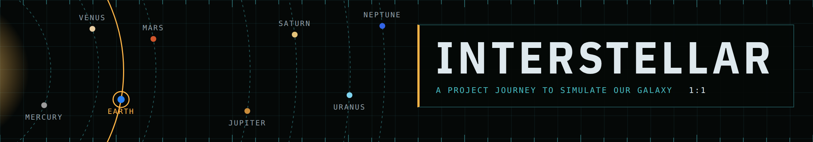
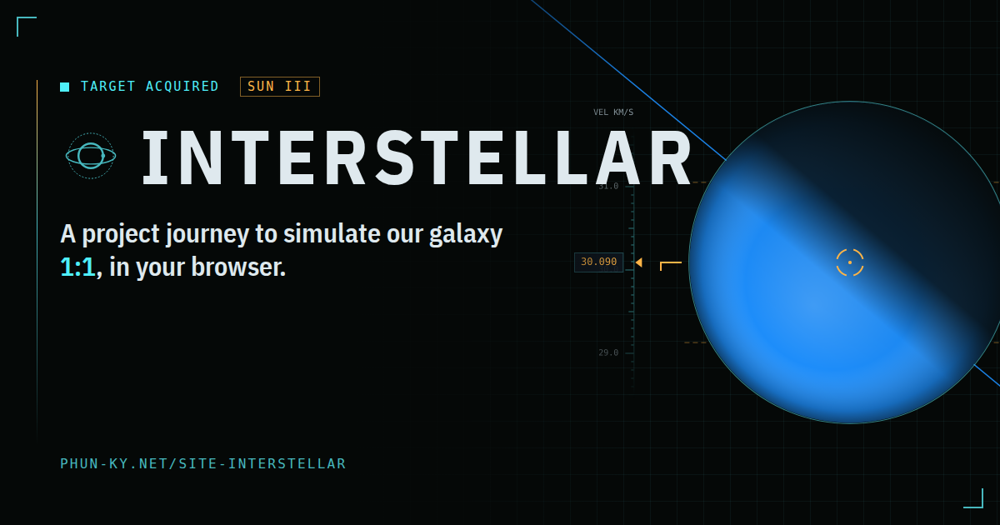

# Interstellar



[](http://commitizen.github.io/cz-cli/)
[](http://makeapullrequest.com)


[](https://github.com/phun-ky/site-interstellar/actions/workflows/deploy.yml)
[](https://codecov.io/gh/phun-ky/site-interstellar)
[](https://www.bestpractices.dev/projects/16380)
[](https://scorecard.dev/viewer/?uri=github.com/phun-ky/site-interstellar)

## About

> A project journey to simulate our galaxy 1:1

**Live:**
[phun-ky.net/site-interstellar](https://phun-ky.net/site-interstellar/)

Interstellar is a small project I dabble with from time to time between clients.
The goal is to ultimately have a 1:1 simulation of our galaxy and to be able to
view information and follow all known celestial bodies, including calculating
trajectories of asteroids.

Today it is a 2D map of the Milky Way's centre with the S-stars round
Sagittarius A\*, nearby stars, TRAPPIST-1, the solar system with its dwarf
planets and interstellar visitors, and the galaxies around the Milky Way, moving
in real time or faster.

- Pan by dragging with the mouse or a finger, and zoom with the wheel or a
  pinch.
- Lock on any star, planet, moon, comet, asteroid, galaxy or black hole to
  follow it and read its details, or find it in the Bodies table.
- Click or tap a body to look at it up close, with its facts, live range and,
  for many, a real image.
- Keep your bearings with a minimap one level up from the map.
- Switch layers such as moons, comets, labels and orbits on and off, and hold,
  speed up or reset the simulation.
- Turn on sounds in Settings. They are off on every visit.

The orbital mechanics come from
[Interstellar Tools](https://phun-ky.net/interstellar-tools/).

### Timeline

- [x] **First version** is to establish a 2d space for celestial bodies and UI
- [ ] **Second version** is to convert to 3d space
- [ ] **Third version** is to use web workers in some extent
- [ ] **Fourth version** is to draw this with WebGL

See the [roadmap](ROADMAP.md) for what is planned next, and what is not.

## Table of Contents<!-- omit from toc -->

- [About](#about)
  - [Timeline](#timeline)
- [Known issues](#known-issues)
- [Development](#development)
- [Contributing](#contributing)
- [License](#license)
- [Changelog](#changelog)
- [Sponsor me](#sponsor-me)



## Known issues

- Orbits are drawn flat, each turned to its real direction: inclination is
  ignored until the map is 3D (see the [timeline](#timeline)).

## Development

```sh
npm ci
npm run dev # http://localhost:3000/site-interstellar/
npm test
npm run build
npm run test:e2e
```

The [contributing guide](CONTRIBUTING.md#your-first-code-contribution) has the
requirements, the architecture, every script and the tests.

## Contributing

Want to contribute? Please read the
[CONTRIBUTING.md](https://github.com/phun-ky/site-interstellar/blob/main/CONTRIBUTING.md)
and
[CODE_OF_CONDUCT.md](https://github.com/phun-ky/site-interstellar/blob/main/CODE_OF_CONDUCT.md)

## License

This project is licensed under a
[GPL-3.0 License](https://choosealicense.com/licenses/gpl-3.0/). - see the
[LICENSE](https://github.com/phun-ky/site-interstellar/blob/main/LICENSE) file
for details.

The surface map of Mars, `src/assets/textures/mars.jpg`, is by
[Solar System Scope](https://www.solarsystemscope.com/textures/), under
[CC BY 4.0](https://creativecommons.org/licenses/by/4.0/).

## Changelog

See the
[CHANGELOG.md](https://github.com/phun-ky/site-interstellar/blob/main/CHANGELOG.md)
for details on the latest updates.

## Sponsor me

I'm an Open Source evangelist, creating stuff that does not exist yet to help
get rid of secondary activities and to enhance systems already in place, be it
documentation or web sites.

The sponsorship is an unique opportunity to alleviate more hours for me to
maintain my projects, create new ones and contribute to the large community
we're all part of :)

[Support me on GitHub Sponsors](https://github.com/sponsors/phun-ky).
